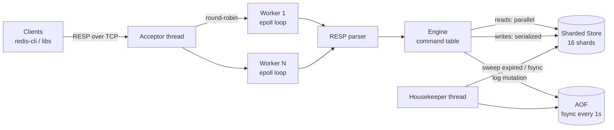

# MaxKV

A Redis-compatible, multi-threaded in-memory key-value server written from scratch in **modern C++20**
with no third-party dependencies — only POSIX sockets, `epoll` and the standard library.

It speaks the real **RESP protocol**, so `redis-cli`, `redis-benchmark` and client libraries in any language can talk to it.

```
redis-cli -p 6380
127.0.0.1:6380> SET session abc EX 60
OK
127.0.0.1:6380> INCR visits
(integer) 1
```

## Highlights

| Area | What is implemented |
|---|---|
| **Networking** | Acceptor + N worker threads, each with its own `epoll` loop over non-blocking sockets; `TCP_NODELAY`, back-pressure via `EPOLLOUT`, pipelining |
| **Protocol** | Incremental RESP parser (arrays of bulk strings + inline commands), binary-safe, hard limits against oversized/malicious input, tested at every possible split point |
| **Storage** | 16-shard hash map with per-shard locks, lazy + active (background sweeper) key expiration, glob matching for `KEYS` |
| **Durability** | Append-only file with crash recovery: a torn tail left by a crash mid-write is detected and truncated on startup; `REWRITE` compacts the log via write-temp-then-atomic-`rename` |
| **Correctness** | Writes are serialized so AOF order equals apply order; reads run in parallel. Relative TTLs are persisted as absolute timestamps so replay is deterministic |
| **Quality** | 21 tests (unit, protocol, persistence, network, concurrency), clean under **ThreadSanitizer** and **AddressSanitizer + UBSan**, CI matrix over all three, `-Wall -Wextra -Wpedantic` clean |

## Commands

`PING` `ECHO` `SET` (`EX` `PX` `PXAT` `NX` `XX`) `GET` `MGET` `DEL` `EXISTS` `EXPIRE` `PEXPIREAT` `TTL`
`INCR` `DECR` `KEYS` `DBSIZE` `FLUSHALL` `INFO` `REWRITE` `QUIT`

## Build & run

```bash
make -j            # builds build/maxkv, build/maxkv_tests, build/maxkv_bench
make test          # run the test suite
make SAN=thread    # ThreadSanitizer build  (also: SAN=address)
./build/maxkv --port 6380 --threads 4 --aof maxkv.aof
```

CMake works too (`cmake -B build && cmake --build build`), and so does Docker:

```bash
docker build -t maxkv . && docker run -p 6380:6380 -v maxkv-data:/data maxkv
```

## Architecture



```
include/kv/  store.hpp  resp.hpp  wal.hpp  engine.hpp  server.hpp
src/         store.cpp  resp.cpp  wal.cpp  engine.cpp  server.cpp  main.cpp
tests/       test_main.cpp      bench/  bench.cpp
```

Design notes worth discussing:

* **Why serialize writes?** The AOF must replay in the same order operations were applied. Holding one write lock
  across *apply + append* guarantees that; it also makes `REWRITE` (snapshot + swap) trivially consistent. Reads stay lock-free
  with respect to that mutex and only contend on a single shard.
* **Why log `PXAT` instead of `EX`?** A relative TTL replayed after a restart would be extended by the downtime.
  Absolute expiry timestamps make replay idempotent.
* **Torn-write recovery:** the parser distinguishes "incomplete" from "corrupt"; replay stops at the first non-OK frame and truncates the file there.

## Benchmark

`make bench` (32 clients, 64-byte values, 70% GET / 30% SET, loopback, benchmark client on the same machine):

| Mode | Throughput | Batch latency (p50 / p99) |
|---|---|---|
| pipeline = 16 | ~1.4–1.6 M ops/s | ~350 µs / ~840 µs |
| pipeline = 1 | ~230 k ops/s | ~130 µs / ~245 µs |

Measured in a **single-core container** with server and load generator competing for the same CPU, persistence disabled —
treat the numbers as indicative only and re-run on your own hardware.

## Known limitations / roadmap

* AOF is `fsync`'d once per second: survives process crashes (`SIGKILL`) but can lose ~1 s of writes on power loss.
* Only string values; no lists/hashes/sets, pub/sub, transactions or replication.
* The parser re-scans a partially received request, so a single multi-megabyte value arriving in many small chunks is O(n²) in the worst case — a resumable parser state machine is the fix.
* Linux-only (`epoll`). A `kqueue`/IOCP backend would make it portable.
* Ideas: LRU eviction + `maxmemory`, RDB-style snapshots, `SCAN`, hashes/lists, TLS, leader–follower replication.
